# Tugas Besar Pengganti UAS — Sub-Topik T1-A

## Evaluasi Kesesuaian Metrik mAP terhadap Akurasi Hitung Sel Darah Tepi Menggunakan YOLOv8s dan Faster R-CNN

**Mata Kuliah:** Deep Learning for Image – Computer Vision Lanjutan (Kelas A)
**Dosen Pengampu:** Dr. Wahyudi Setiawan, S.Kom., M.Kom.
**Program Studi:** S1 Sistem Informasi, Fakultas Teknik, Universitas Trunojoyo Madura

[](https://colab.research.google.com/github/putriekasfr/UAS-DL-Kelompok5-T1A-TXL-PBC/blob/main/notebooks/01_M2_Audit_EDA_Baseline.ipynb) M2 · [](https://colab.research.google.com/github/putriekasfr/UAS-DL-Kelompok5-T1A-TXL-PBC/blob/main/notebooks/02_M3_Main_Experiments_Ablations_XAI.ipynb) M3

### Identitas Tim (Kelompok 5)

| No | NIM | Nama Lengkap | Peran Utama | Studi Ablasi (1-Faktor) |
|---|---|---|---|---|
| 1 | 240441100052 | Tsabita Shafa Aurellia | Ketua tim; audit data & EDA; jalur YOLOv8s (R01, R04, R07, R08); evaluasi, korelasi mAP–MAE, efisiensi & EigenCAM | Resolusi masukan YOLOv8s (640 vs 832 px) |
| 2 | 240441100087 | Putri Eka Safira | Split, konversi COCO & uji kebocoran; jalur Faster R-CNN (R02, R06, R09, R10); set uji, uji statistik & analisis kesalahan | Backbone Faster R-CNN (fine-tune penuh vs beku) dan ambang IoU NMS (0,45 / 0,60 / 0,75) |

### Daftar Deliverable Resmi (M1 – M3) & Arsip Bobot

| Milestone | Dokumen | Berkas | Tautan | Keterangan Ringkas |
|---|---|---|---|---|
| M1 | Proposal Proyek | `docs/Proposal_M1_T1A_Kelompok5.pdf / .docx` | [PDF](https://github.com/putriekasfr/UAS-DL-Kelompok5-T1A-TXL-PBC/blob/main/docs/Proposal_M1_T1A_Kelompok5.pdf) | Latar belakang, RQ & hipotesis, dataset, rencana eksperimen, pembagian peran (2 hal) |
| M2 | Laporan Kemajuan | `docs/Laporan_Kemajuan_M2_T1A_Kelompok5.pdf / .docx` | [PDF](https://github.com/putriekasfr/UAS-DL-Kelompok5-T1A-TXL-PBC/blob/main/docs/Laporan_Kemajuan_M2_T1A_Kelompok5.pdf) | Audit data, split tetap, uji kebocoran & baseline R01/R02 |
| M3 | Laporan Akhir (Artikel SINTA 2) | `docs/Laporan_Akhir_T1A_Kelompok5.pdf / .docx` | [PDF](https://github.com/putriekasfr/UAS-DL-Kelompok5-T1A-TXL-PBC/blob/main/docs/Laporan_Akhir_T1A_Kelompok5.pdf) | 12 hal 2-kolom, struktur Lampiran B, abstrak EN 185 kata, 10 rujukan |
| M3 | Slide Presentasi | `docs/Slide_T1A_Kelompok5.pdf / .pptx` | [PDF](https://github.com/putriekasfr/UAS-DL-Kelompok5-T1A-TXL-PBC/blob/main/docs/Slide_T1A_Kelompok5.pdf) | 15 slide 16:9, catatan pembicara & slide "Apa yang tidak berhasil" |
| M3 | Model Card | `docs/Model_Card_T1A_Kelompok5.pdf / .docx` | [PDF]() | Rincian model, kegunaan, kinerja uji, keterbatasan & etika |
| M3 | Lembar Kontribusi | `docs/Lembar_Kontribusi_T1A_Kelompok5.pdf / .docx` | [PDF]() | Ablasi per anggota, pembagian kerja, menit GPU & tanda tangan |
| M3 | Penilaian Sejawat | `docs/Penilaian_Sejawat_T1A_Kelompok5.pdf / .docx` | [PDF]() | Formulir penilaian antaranggota |
| Bobot | Checkpoint model (R01–R10) | Google Drive `runs/` | [Drive](https://drive.google.com/drive/folders/1JXp1aXMuHhHMx94U1CqYb0PJrNUSFMY4?usp=sharing) | best.pt / last.pt semua run (± 1 GB) |

---

## 1. Deskripsi Masalah & Dataset Resmi (TXL-PBC)

Sistem hitung sel darah otomatis biasanya dipilih berdasarkan **mAP**, padahal kebutuhan klinis adalah **jumlah sel yang benar** per citra. Proyek ini menguji pertanyaan riset **T1-A**: *apakah mAP tinggi menjamin hitungan sel yang akurat pada detektor one-stage (YOLOv8s) dan two-stage (Faster R-CNN ResNet-50-FPN)?*

- **Sumber & sitasi:** Gan, L., Li, X., & Wang, X. (2025). *A curated and re-annotated peripheral blood cell dataset integrating four public resources (TXL-PBC).* arXiv:2407.13214v2.
- **Isi:** 1.260 citra apusan darah tepi dari 4 sumber: PBC (500), Raabin-WBC (500), BCCD (160), BCDD (100).
- **Kelas deteksi:** WBC, RBC, platelet (format label YOLO).
- **Hipotesis (proposal M1):**
  - **H1:** |Spearman ρ| antara mAP@[.5:.95] dan MAE hitung RBC antar konfigurasi < 0,5.
  - **H2:** mengubah IoU NMS 0,45–0,75 mengubah MAE RBC < 0,10 sel/citra.
  - **H3:** resolusi 832 px menurunkan MAE platelet ≥ 10%, dan MAPE platelet tertinggi pada kedua model.
- **Etika data:** dataset tidak diunggah ulang di repositori ini; notebook mengunduhnya langsung dari repositori resmi TXL-PBC.

## 2. Hasil Audit Data, Verifikasi Visual & Evaluasi Baseline (Milestone M2)

Audit oleh notebook M2 (`outputs/eda/`, `outputs/leakage/`) sebelum pelatihan:

- **Label duplikat:** 47 baris label identik di 5 berkas dibuang (18.143 → **18.096 kotak unik**: WBC 1.291, RBC 16.262, platelet 543) — `outputs/eda/label_duplikat.csv`.
- **Ketimpangan kelas & ukuran:** RBC ± 90% kotak; **43,6% platelet berukuran small** (< 32² px), tidak ada WBC/RBC yang small; ukuran sel berbeda hingga 2,2× antar sumber.
- **Split tetap (seed 42):** split resmi `splits/train.txt` (882) · `splits/val.txt` (252) · `splits/test.txt` (126).
- **Verifikasi konversi YOLO → COCO:** dicek visual pada 20 citra (Gambar 6).
- **Uji kebocoran (MD5 + pHash, Hamming ≤ 8):** 0 berkas identik, **0 pasangan latih–uji** (jarak terdekat 10), 2 pasangan latih–validasi Raabin-WBC dilaporkan — `outputs/leakage/ringkasan_kebocoran.csv`.

**Ringkasan baseline M2 (set validasi, seed 42, Google Colab Tesla T4)** — `outputs/eval/val_deteksi.csv`, `outputs/eval/val_galat_hitung.csv`:

| Run | Model | Param | mAP@0,5 | mAP@[.5:.95] | AP small | MAE WBC | MAE RBC | MAE platelet | MAPE platelet | GPU (menit) |
|---|---|---|---|---|---|---|---|---|---|---|
| R01 | YOLOv8s (640 px, 60 epoch) | 11,14 M | 0,972 | **0,848** | 0,727 | **0,008** | 0,960 | 0,075 | 16,2% | 17,7 |
| R02 | Faster R-CNN R50-FPN (12 epoch) | 41,31 M | **0,981** | 0,824 | 0,726 | 0,012 | **0,679** | **0,048** | **7,7%** | 25,4 |

Temuan awal: YOLOv8s lebih tinggi di mAP@[.5:.95], tetapi Faster R-CNN menghitung RBC 29% dan platelet 37% lebih akurat.

| Gambar | Isi |
|---|---|
| 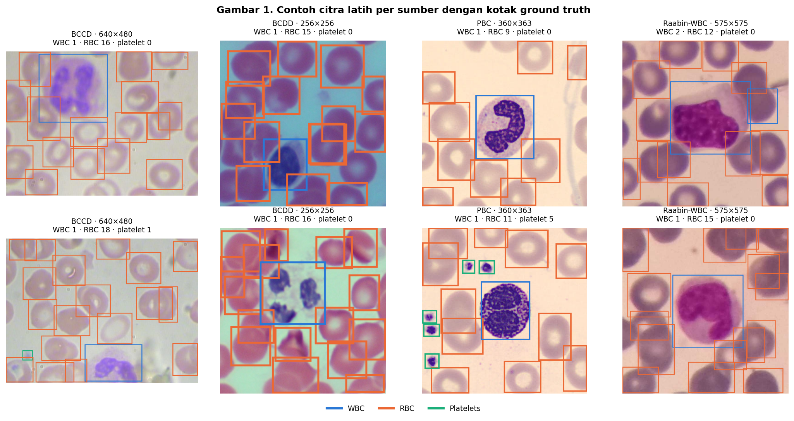 | **Gambar 1.** Contoh citra & anotasi per sumber |
| 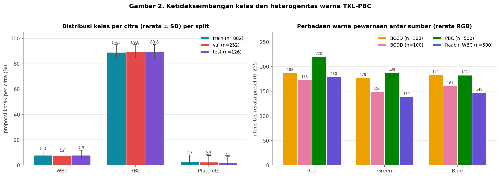 | **Gambar 2.** Distribusi kelas per split & warna per sumber |
| 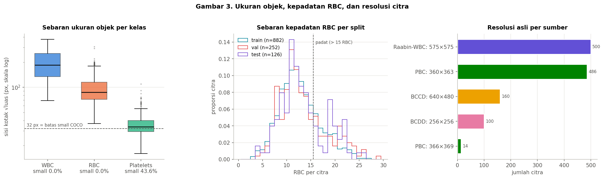 | **Gambar 3.** Ukuran objek, kepadatan RBC & resolusi |
| 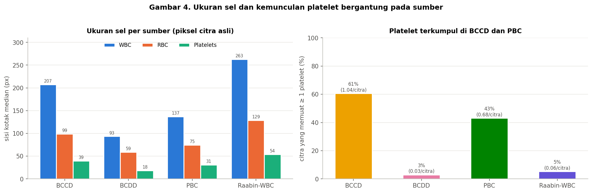 | **Gambar 4.** Ukuran sel & platelet per sumber |
| 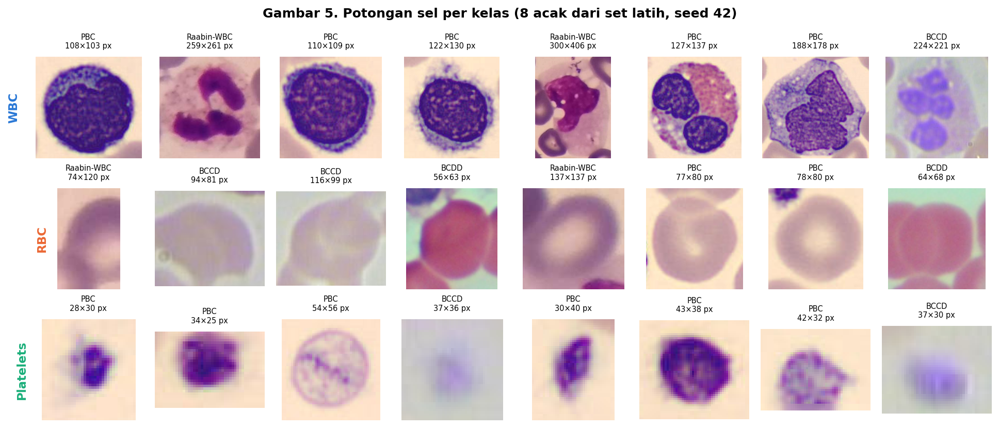 | **Gambar 5.** Potongan objek per kelas |
| 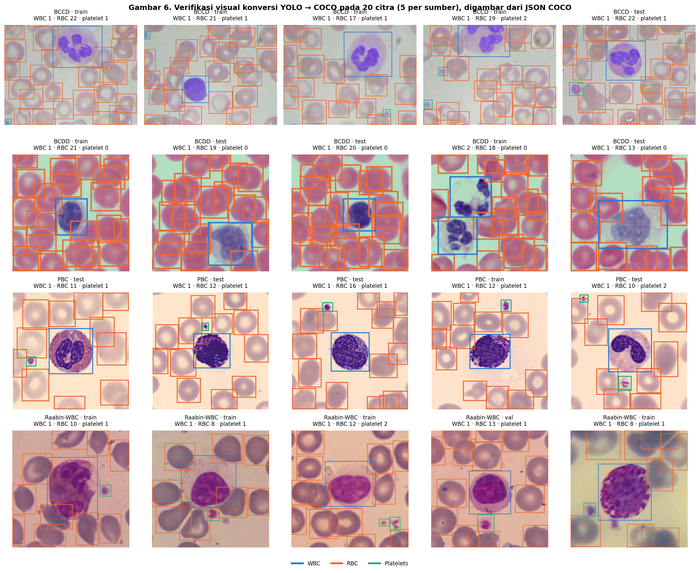 | **Gambar 6.** Verifikasi konversi COCO pada 20 citra |
| 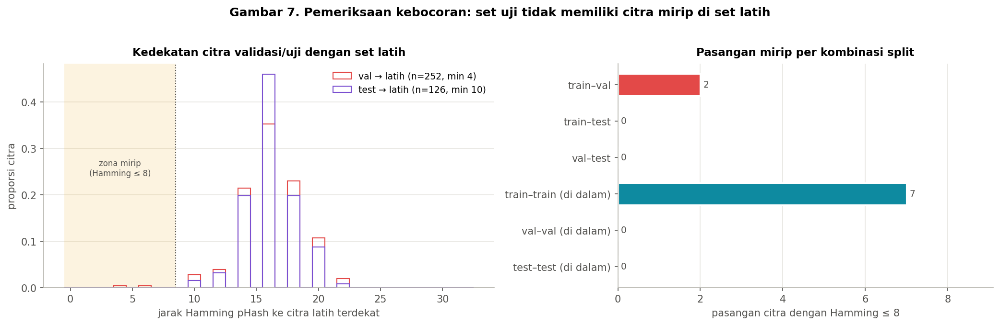 | **Gambar 7.** Pemeriksaan kebocoran pHash |
| 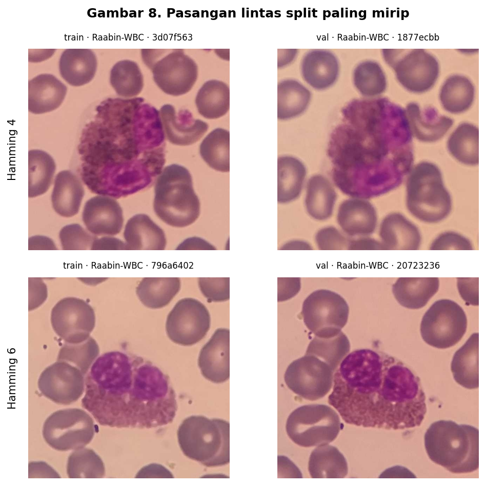 | **Gambar 8.** Pasangan citra terdekat antar split |

## 3. Hasil Eksperimen Utama, Studi Ablasi & Analisis XAI (Milestone M3)

Seluruh **14 run/varian selesai** (0 gagal) dengan total **185 menit GPU Tesla T4** — `experiments/log.csv`. Konfigurasi terbaik di validasi (**R04** untuk YOLOv8s, **R02** untuk Faster R-CNN) diulang dengan seed 123 dan 2024; set uji dibuka **satu kali** untuk 6 run final (`outputs/eval/SET_UJI_DIBUKA.txt`).

### A. Tabel Utama Set Uji (3 seed, rerata ± simpangan baku) — `outputs/eval/test_utama_mean_sd.csv`

| Metrik | YOLOv8s (R04, R07, R08) | Faster R-CNN (R02, R09, R10) | p (uji-t berpasangan) |
|---|---|---|---|
| mAP@0,5 | 0,983 ± 0,003 | **0,992 ± 0,001** | 0,042 |
| mAP@[.5:.95] | **0,863 ± 0,005** | 0,848 ± 0,002 | 0,050 |
| AP small / medium / large | 0,784 / **0,874** / 0,663 | **0,802** / 0,859 / **0,788** | – |
| AP WBC / RBC / platelet | **0,886 / 0,892** / 0,810 | 0,847 / 0,875 / **0,822** | 0,04 / 0,01 / 0,16 |
| MAE WBC (sel/citra) | 0,013 ± 0,005 | **0,008 ± 0,008** | 0,42 |
| MAE RBC (sel/citra) | 0,905 ± 0,035 | **0,786 ± 0,035** | selisih −0,119 sama di 3 seed |
| MAE platelet (sel/citra) | 0,048 ± 0,024 | **0,032 ± 0,008** | 0,48 |
| MAPE RBC / platelet | 7,7% / 11,8% | **6,0% / 5,9%** | – |

**Korelasi mAP vs galat hitung** (14 konfigurasi validasi, `outputs/eval/val_korelasi_map_mae.csv`): mAP@[.5:.95] berkorelasi **positif** dengan MAE RBC (Spearman ρ = 0,52; Pearson r = 0,63, p = 0,015) dan MAE platelet (ρ = 0,69, p = 0,006) — mAP lebih tinggi justru disertai hitungan lebih buruk. Di dalam satu paradigma korelasinya hampir nol (Faster R-CNN ρ = −0,05; YOLOv8s ρ = −0,17).

**Jawaban hipotesis:** H1 tidak didukung (korelasi sedang & berlawanan arah) · H2 didukung untuk YOLOv8s (rentang 0,004) tetapi tidak untuk Faster R-CNN (0,333) · H3 tidak didukung (MAE platelet −5%; MAPE platelet Faster R-CNN 5,9% < RBC 6,0%).

### B. Ringkasan Studi Ablasi & Efisiensi (validasi, seed 42)

- **Tsabita — Resolusi YOLOv8s (R04 vs R01):** 832 px hanya menaikkan mAP@[.5:.95] 0,848 → 0,849 dan AP small 0,727 → 0,732; MAE platelet turun 5% (0,075 → 0,071) dengan biaya GPU 38% lebih besar.
- **Putri — Backbone Faster R-CNN (R06 vs R02):** backbone beku menurunkan mAP@[.5:.95] 0,824 → 0,786 dan menaikkan MAE RBC 13% (0,679 → 0,766).
- **Putri — Ambang IoU NMS (tanpa latih ulang, `outputs/eval/val_ablasi_nms.csv`):** YOLOv8s stabil (MAE RBC 0,960–0,964); Faster R-CNN mAP konstan (0,824–0,825) tetapi **MAE RBC naik 0,679 → 0,794 → 1,012** saat IoU 0,45 → 0,60 → 0,75.
- **Efisiensi (Tesla T4, batch 1, `outputs/eval/efisiensi.csv`):** YOLOv8s 11,14 M param, **20,1 ms** (49,9 citra/detik); Faster R-CNN 41,31 M param, 66,3 ms (15,1 citra/detik), 3,3× lebih lambat.

### C. Analisis Kesalahan, Kepadatan & Interpretasi EigenCAM

- **Kepadatan & sumber (`outputs/eval/test_mae_per_sumber.csv`):** keunggulan Faster R-CNN terbalik pada citra padat (> 15 RBC: MAE 1,41 vs 1,04) dan pada BCCD (1,56 vs 1,04).
- **Kategori kesalahan (set uji, R04 vs R02):** FN didominasi sel terpotong tepi (29 vs 32); FP YOLOv8s didominasi latar/artefak (74; 65,5%), FP Faster R-CNN didominasi lokalisasi buruk (47; 49,5%).
- **EigenCAM (`outputs/eval/xai_energi_test.csv`):** energi Faster R-CNN terpusat di sel (hanya 2,4% di latar), sedangkan YOLOv8s tersebar (22,8% di latar) dan sering menyala di sela antar-RBC.

| Gambar | Isi |
|---|---|
| 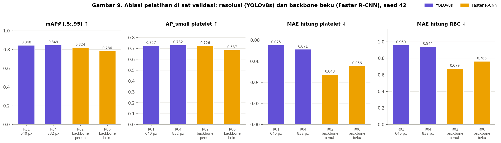 | **Gambar 9.** Ablasi resolusi & backbone beku |
| 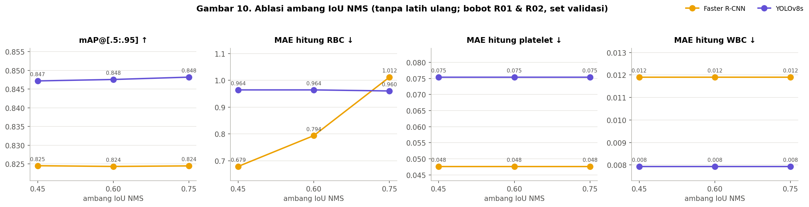 | **Gambar 10.** Ablasi ambang IoU NMS |
| 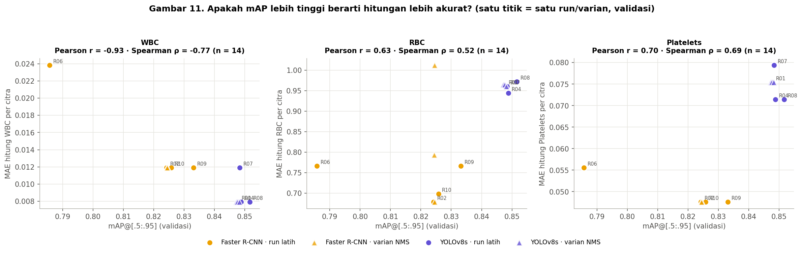 | **Gambar 11.** Korelasi mAP vs MAE hitung (14 konfigurasi) |
| 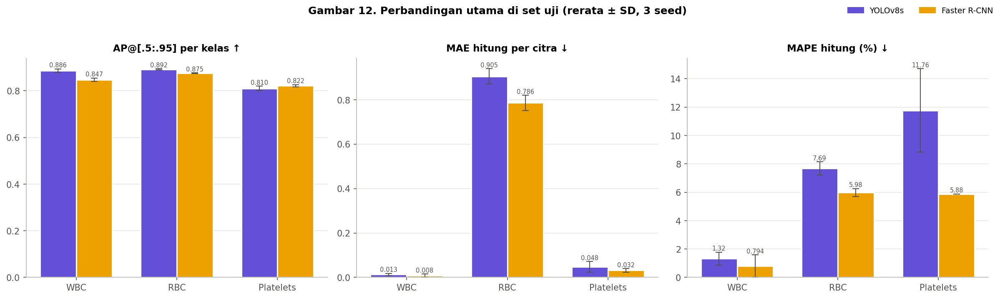 | **Gambar 12.** Perbandingan utama set uji (3 seed) |
| 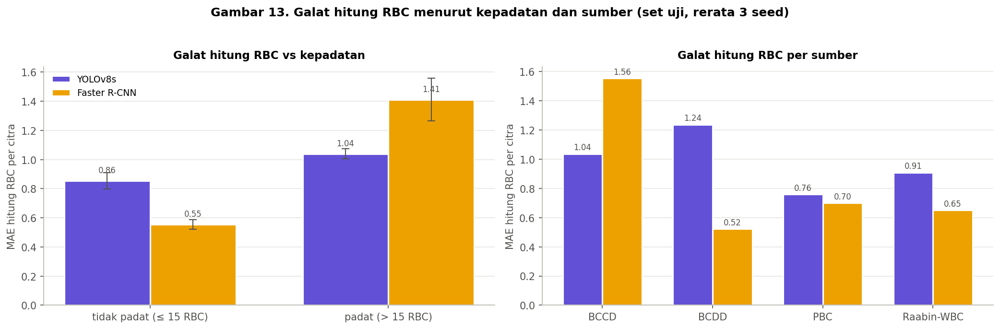 | **Gambar 13.** Galat hitung menurut kepadatan & sumber |
| 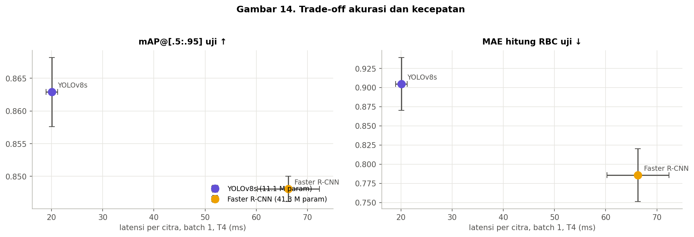 | **Gambar 14.** Trade-off akurasi & kecepatan |
| 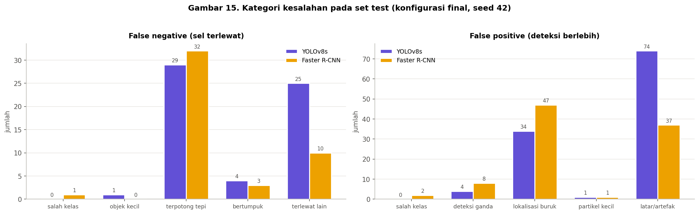 | **Gambar 15.** Kategori FN/FP |
| 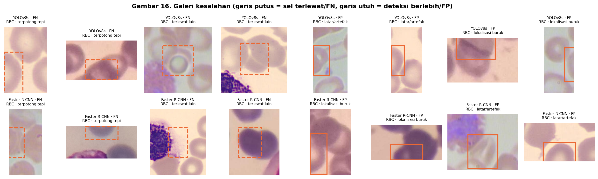 | **Gambar 16.** Galeri kesalahan berkategori |
| 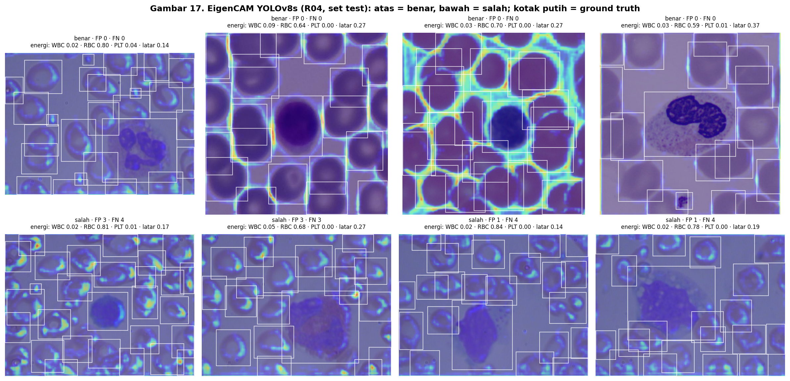 | **Gambar 17.** EigenCAM YOLOv8s |
| 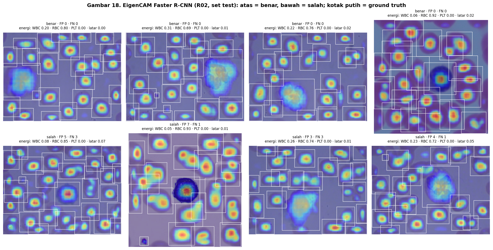 | **Gambar 18.** EigenCAM Faster R-CNN |
| 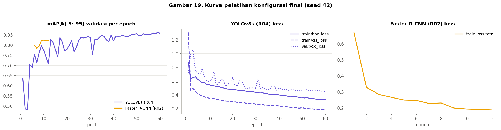 | **Gambar 19.** Kurva pelatihan |

## 4. Struktur Repositori & Panduan Reproduksibilitas (Google Colab)

```
├── configs/                 # R01–R10.yaml; `inherits` menyalin run lain lalu mengubah satu faktor
├── docs/                    # Proposal M1, Laporan M2, Laporan Akhir, Slide, Model Card, Lembar Kontribusi,
│                            # Penilaian Sejawat (.pdf/.docx/.pptx) + SKENARIO.md
├── experiments/
│   ├── log.csv              # Log semua 14 run/varian: status, menit GPU, metrik validasi, τ, catatan
│   ├── log_runs/            # Catatan per run (aman untuk dua akun Colab yang berjalan bersamaan)
│   └── env/                 # Versi pustaka & GPU per run
├── notebooks/
│   ├── 01_M2_Audit_EDA_Baseline.ipynb              # M2: audit, EDA, split, COCO, kebocoran, baseline R01/R02
│   └── 02_M3_Main_Experiments_Ablations_XAI.ipynb  # M3: ablasi, 3 seed, korelasi, set uji, efisiensi, kesalahan, EigenCAM
├── outputs/
│   ├── eda/ · leakage/      # Tabel audit data & kebocoran
│   ├── eval/                # Semua tabel hasil (validasi, uji, korelasi, uji statistik, efisiensi, kesalahan, XAI)
│   └── figures/             # Gambar 1–19
├── splits/                  # train.txt (882) · val.txt (252) · test.txt (126), seed 42
├── src/
│   ├── data_utils.py        # Baca label YOLO, buang duplikat, konversi COCO
│   ├── leakage.py           # MD5 & pHash untuk uji kebocoran
│   ├── yolo_utils.py        # Latih & prediksi YOLOv8s (Ultralytics), prediksi per 16 citra (hemat VRAM)
│   ├── frcnn.py             # Latih & prediksi Faster R-CNN (torchvision), checkpoint & lanjut otomatis
│   ├── pipeline.py          # Alur run (latih → prediksi → evaluasi → log), ablasi NMS, pemilihan konfigurasi
│   ├── run_job.py           # Menjalankan tiap run di proses terpisah agar VRAM/RAM kosong kembali
│   ├── evaluate.py          # mAP pycocotools, hitung per kelas, MAE/MAPE, pemilihan τ
│   ├── summary.py           # Rekap rerata ± SD, korelasi Pearson/Spearman
│   ├── errors.py            # Pencocokan & kategori FN/FP
│   ├── xai.py               # EigenCAM YOLOv8s & Faster R-CNN, energi per kelas
│   ├── efficiency.py        # Parameter & latensi batch 1
│   ├── exp_log.py · paths.py · viz.py
├── VERSION                  # Penanda versi folder proyek yang dicari notebook
└── requirements.txt
```

**Langkah menjalankan di Google Colab (GPU T4):**

1. Unggah isi repositori ke satu folder di Google Drive (bobot model opsional: salin folder `runs/` dari tautan Drive di atas agar pelatihan di-SKIP).
2. Buka `notebooks/01_M2_Audit_EDA_Baseline.ipynb` (tombol *Open in Colab* di atas), pilih **Runtime → Change runtime type → T4 GPU**, lalu **Run all**: audit data, split, kebocoran, dan baseline R01/R02 (± 45 menit).
3. Buka `notebooks/02_M3_Main_Experiments_Ablations_XAI.ipynb`, lalu **Run all**: ablasi (R04, NMS, R06), multi-seed (R07–R10), set uji sekali, korelasi, uji statistik, efisiensi, analisis kesalahan & EigenCAM (± 2,5 jam). Bila sesi Colab terputus, **Run all** lagi: run yang selesai di-SKIP dan yang setengah jalan dilanjutkan dari checkpoint.
4. Tabel utama tersimpan di `outputs/eval/test_utama_mean_sd.csv`; semua gambar di `outputs/figures/`.

Versi pustaka: Python 3.13 · PyTorch 2.14.1 · torchvision 0.29.1 · Ultralytics 8.4.216 · pycocotools 2.0.11 (lengkap di `experiments/env/`).

## 5. Deklarasi Etika & Penggunaan Alat Bantu

- Seluruh kode dan model pada repositori ini merupakan prototipe riset akademik untuk mata kuliah Computer Vision Lanjutan, **bukan alat diagnosis medis**.
- Asisten AI generatif digunakan untuk membantu menulis kode notebook dan modul, membuat visualisasi, serta menyusun draf dokumen. Seluruh pelatihan dan evaluasi dijalankan oleh anggota Kelompok 5 di Google Colab; semua angka berasal dari keluaran notebook dan telah diperiksa ulang oleh kelompok.


